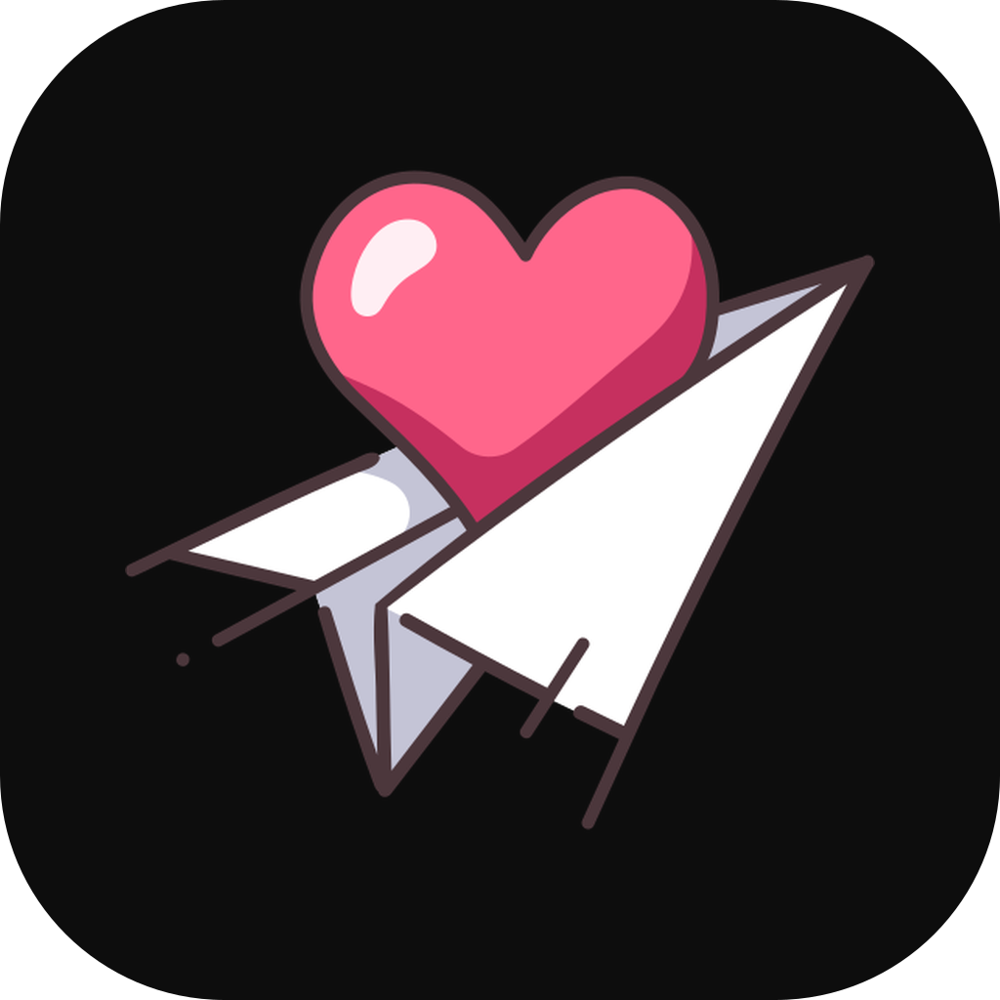
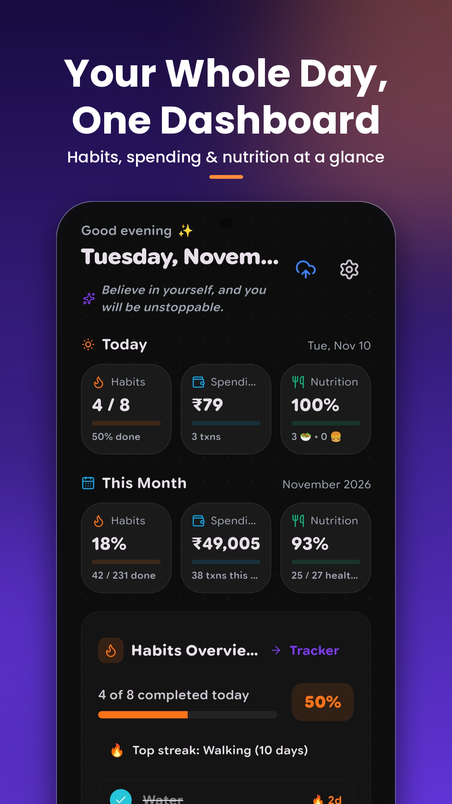
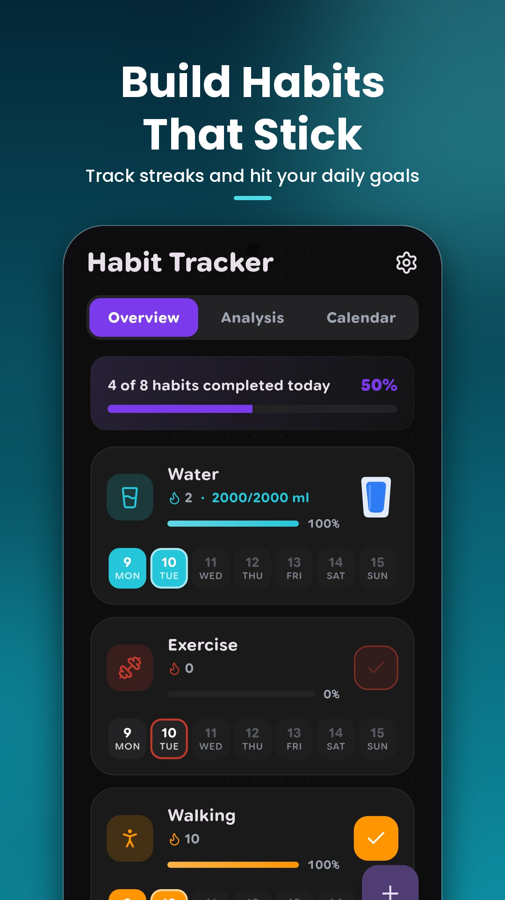
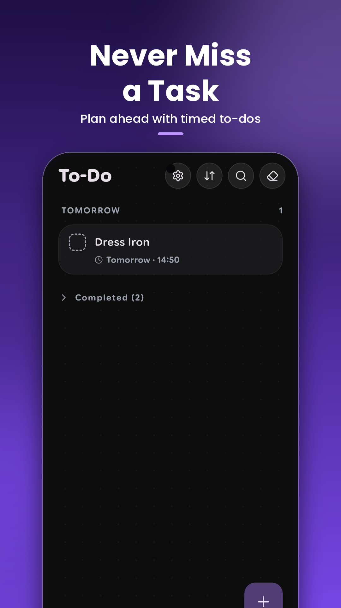
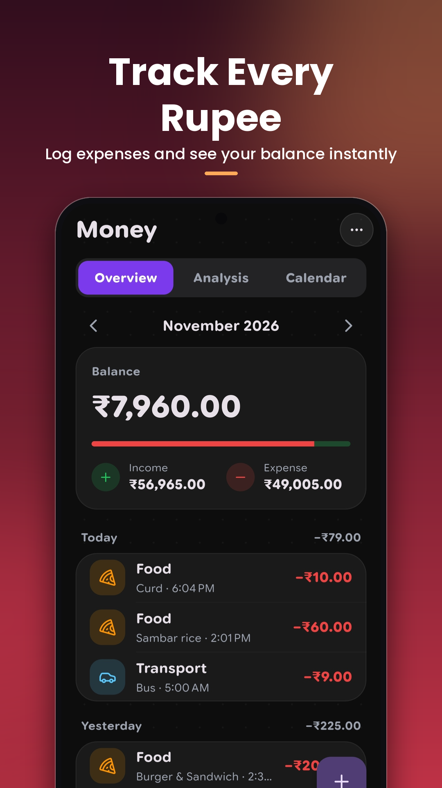
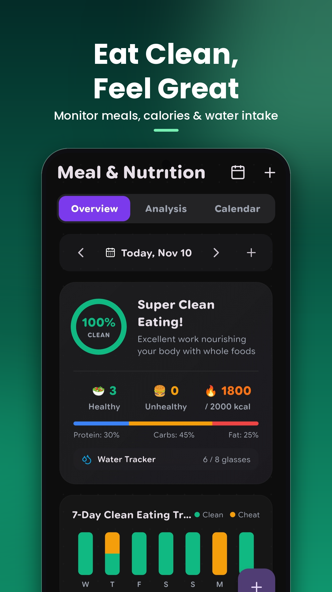

# Soul State

### The private, offline, ad-free life operating system for Android

**Habit Tracker · To-Do & Repeating Alarms · Expense Tracker · Calorie & Meal Log · Obsidian Markdown Vault · AWS S3 Sync**

*Build discipline, track your money, eat mindfully and stay focused, all in one app that never leaves your device.*

  
  
  
  
  
  
  

  
  

 

  <a href="#-screenshots">Screenshots</a> ·
  <a href="#-why-soul-state">Why Soul State</a> ·
  <a href="#-core-features">Features</a> ·
  <a href="#-soul-state-vault-obsidian--markdown">Vault</a> ·
  <a href="#%EF%B8%8F-aws-s3-cloud-sync">S3 Sync</a> ·
  <a href="#-privacy--freedom">Privacy</a> ·
  <a href="#-faq">FAQ</a>

---

## 📸 Screenshots

  
  
  
  
  

---

## ✨ About Soul State

**Soul State** is an open-source, offline-first **habit tracker, to-do app, expense tracker and calorie counter** in a single Android app. It is built with Flutter to help you grow self-discipline, mindful health, financial awareness and daily focus, without accounts, ads or tracking.

Your data lives in plain **Markdown files** that open directly in **Obsidian**, Logseq or any text editor, and can optionally sync across devices through your own **AWS S3** bucket.

> **No mandatory account. No advertisements. No tracking. Complete data ownership.**

---

## 💡 Why Soul State

| Instead of... | Soul State gives you |
|---|---|
| Five separate apps for habits, tasks, money and meals | One unified dashboard |
| Cloud lock-in and subscriptions | Free, open source (GPLv3), your files |
| Ads and analytics trackers | Zero ads, zero telemetry |
| Data trapped in a proprietary database | Human-readable Markdown, Obsidian ready |
| Needing internet to log a habit | 100% offline |

---

## 🚀 Core Features

### 🎯 Habit Tracker

- **One-tap logging** from the Today dashboard, with custom streak counters.
- **Multiple habit kinds**
  - *Positive habits*: daily progress, streaks and target frequencies.
  - *Avoid / negative habits*: quit bad habits with relapse tracking and clean streaks.
  - *Quantitative habits*: track pages read, water glasses, gym sets or practice minutes.
- **Checklists** to break complex routines into sub-steps.
- **Flexible scheduling**: daily, specific weekdays, every *N* days or monthly goals.
- **Vacation mode** to pause habits while travelling, plus clean deletion with no clutter.

### 🔔 To-Do Tasks & Repeating Alarms

- **Focused task management** with clean lists, tag filtering and search.
- **Persistent repeating alarms** with custom time, date, sound and message so you never miss a critical task.
- **Instant vault sync**: every task created or completed is written to `tasks.md` in your vault.
- **Priority & pinning**: pin crucial tasks to the top and set duration estimates.

### 💰 Money & Personal Finance

- **Income and expense tracking** alongside your daily routines.
- **Category insights** with visual breakdowns, custom icons and color palettes.
- **Currency support**: ₹ Rupee, $ Dollar, € Euro, £ Pound, ¥ Yen and custom symbols.
- **Real-time balance** with a clean, unified + action button.

### 🥗 Meal & Nutrition Tracker

- **Daily meal journal**: log Breakfast, Lunch, Dinner and Snacks in a tap.
- **Clean eating score**: healthy vs. cheat meal ratio with actionable feedback.
- **Calorie target**: progress bar against your customizable daily goal.
- **Macro breakdown**: live Protein, Carbohydrate and Fat ratios.
- **Water intake tracker** for daily hydration.

---

## 📂 Soul State Vault (Obsidian & Markdown)

Soul State treats your device storage as the single source of truth.

- **Local Markdown files**: habits, completions, to-dos, meals and finances are stored as readable files (`habits/*.md`, `tasks.md`, `meals.md`, `finances.md`, `README.md`).
- **Obsidian compatible**: open the vault folder in **Obsidian**, Logseq or any Markdown editor to browse graphs, edit checklists and back up with your existing sync tools.
- **Instant persistence**: adding a task, logging a meal or ticking a habit writes straight to your vault.

---

## ☁️ AWS S3 Cloud Sync

Keep your vault in sync across every device.

- **Direct S3 sync** with your own AWS bucket.
- **Instant multi-device setup**: enter your S3 credentials on a new device to pull your full vault (`habits`, `tasks`, `meals`, `finances`) and regenerate local Markdown.
- **End-to-end encryption**: optional AES-256 password protection for cloud backups.
- **Manual & background sync**: a one-tap sync button plus automatic periodic sync.

---

## 🔒 Privacy & Freedom

- **100% offline capable**: no internet required.
- **No account required**: open the app and start.
- **No telemetry or tracking**: zero trackers, analytics libraries or data collection.
- **App lock**: biometric fingerprint or device passcode.

---

## ❓ FAQ

**Is Soul State free?**
Yes. It is free and open source under GPLv3, with no ads or in-app purchases.

**Does it work without internet?**
Yes. Everything works offline; S3 sync is optional.

**Can I use it with Obsidian?**
Yes. Point Obsidian at your Soul State Vault folder and your data appears as Markdown notes.

**Where is my data stored?**
On your device, in your vault folder, and in your own S3 bucket if you enable sync.

---

## 🛠️ Built With

Flutter · Dart · Markdown · AWS S3 · AES-256 encryption

---

## 👤 Author & Support

- **Lead developer**: [Shanmugananthan](https://buymeacoffee.com/shanmugananthan)
- **Support the project**: [Buy me a coffee ☕](https://buymeacoffee.com/shanmugananthan)
- **Package ID**: `com.shanmugananthan.soulstate`

⭐ If Soul State helps you, **star the repo** and share it with someone building better habits.

---

## 📄 License

Soul State is free and open-source software licensed under the **GNU General Public License v3.0 (GPLv3)**.

<!--
Suggested GitHub topics: habit-tracker, flutter, android, offline-first, privacy, obsidian,
markdown, expense-tracker, todo, calorie-counter, aws-s3, open-source, self-hosted, productivity
-->
